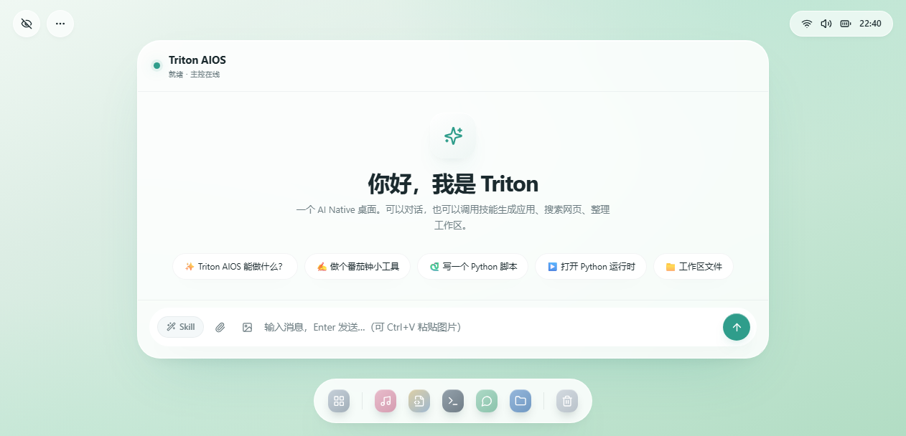
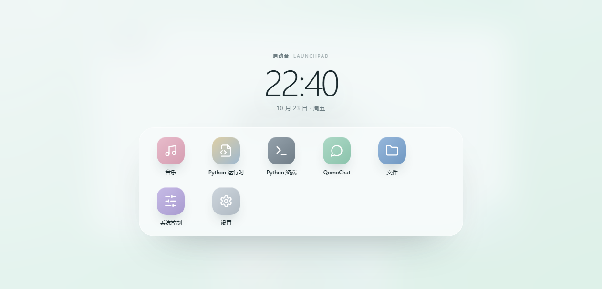

# Triton AIOS

**AI Native Desktop · Preview 0.1.0**

一个把对话、技能、应用和本地文件放进同一张桌面的 AI 原生工作台。
视觉语言基于 **VeliUI**：轻盈通透、层级分明、克制优雅、数据优先。



---

## 这是什么

Triton AIOS 是一个可本地运行的 AI 桌面原型：

- **一个对话框就是系统入口**：自然地聊天，或让它调用技能完成具体任务
- **技能（Skill）按对话隔离**：每条对话记住自己的技能，互不影响
- **AI 写应用**：一句话生成可运行的网页应用，直接出现在任务栏与启动台
- **系统界面技能**：通过改 HTML / CSS 源码换界面，自带备份与回滚
- **联网搜索**：真实搜索 + 抓取正文 + 带来源回答
- **添加技能**：上传 txt / json 提示词即可扩展，也支持对话创建
- **桌面级窗口**：可拖动、可缩放、可最小化，任务栏小点表示程序仍在运行
- **VeliUI 视觉**：大圆角、胶囊控件、同色弥散阴影、深浅色主题



预览版不包含任何聊天记录、个人文件或 API Key。首次启动会看到一组示例对话。

---

## 快速开始

### 环境要求

- Python **3.11+**（已在 3.12 上验证）
- 建议 Windows 10/11（Linux / macOS 同样可运行）

### 方式一：一键启动（Windows）

双击 `run_preview.bat`。首次运行会自动创建虚拟环境并安装依赖，然后打开：

```
http://127.0.0.1:8000
```

### 方式二：手动启动

```bash
python -m venv .venv

# Windows
.venv\Scripts\activate
# macOS / Linux
source .venv/bin/activate

pip install -r requirements.txt
uvicorn desktop_app:app --host 127.0.0.1 --port 8000
```

浏览器打开 <http://127.0.0.1:8000>。

---

## 配置模型

启动后可以在桌面「启动台 → 设置」里填写 API Key，或者用环境变量：

```bash
# Windows PowerShell
$env:DEEPSEEK_API_KEY="sk-..."
$env:LLM_BASE_URL="https://api.deepseek.com"
$env:LLM_MODEL="deepseek-chat"
```

也可以复制 `config.example.json` 为 `config.local.json` 填写（该文件不会被提交或打包）：

```json
{
  "deepseek_api_key": "sk-...",
  "llm_model": "deepseek-chat"
}
```

配置读取优先级：**环境变量 > config.local.json > config.json**。

`config.json` 是公开默认配置（不含任何密钥）；`config.local.json` 只保存在本机。

---

## 内置技能

| 技能 | 做什么 | 触发 |
| --- | --- | --- |
| **AI 写应用** | 读应用 SDK，生成 `apps/<id>/manifest.json + index.html`，直接可运行 | 面板选择 / 「做个…小工具」 |
| **系统界面** | 改 `static/index.html`、`styles.css`、`veli.css`，持久生效、可回滚 | 面板选择 / 「改 HTML」 |
| **联网搜索** | DuckDuckGo / Bing / 百度多引擎降级 + 正文抓取 | 面板选择 / 「搜一下」 |
| **添加技能** | 上传 txt/json 提示词，或对话创建新技能 | 面板选择 / 「添加技能」 |

设计说明见 [docs/skills-design.md](docs/skills-design.md)，应用 SDK 见 [docs/APP_SDK.md](docs/APP_SDK.md)。

---

## 目录结构

```
TritonAIOS/
├─ desktop_app.py        FastAPI 入口（挂载所有路由）
├─ agents.py             主控：对话、技能调度、工具执行、SSE
├─ skills/               技能注册表 + 4 个内置技能 + 自定义技能
├─ static/               桌面前端（index.html / app.js / styles.css / veli.css）
├─ apps/                 应用目录（music / python / qomochat / 工作区）
├─ docs/                 设计文档、SDK、截图
├─ data/                 对话持久化（预览版为空）
├─ config.json           公开默认配置
├─ config.local.json     本机私密配置（不入包）
└─ run_preview.bat       Windows 一键启动
```

数据都保存在本地：对话在 `data/conversations.json`，Agent 文件在工作区
`apps/system_agent/workspace/`，上传的附件在 `workspace/uploads/`。

---

## 预览版说明

- 这是**本地单用户**预览版，没有登录、权限与多租户隔离，请勿直接暴露到公网。
- AI 能力取决于所配置的模型：默认使用 OpenAI 兼容接口，图片理解需要模型支持 `image_url`。
- 音乐应用不附带任何音频文件，请把自己拥有版权的音乐放进
  `apps/music_app/workspace/music/`。
- QomoChat 是可选功能，默认指向 `http://127.0.0.1:5000`，可在设置或 `config.local.json` 里改。
- 生成的应用运行在 iframe 中，可以调用本机同源 API；请只安装你信任的生成结果。
- 预览版仍在迭代，接口与数据格式可能变化。

---

## 打包

运行：

```powershell
powershell -ExecutionPolicy Bypass -File scripts/package_preview.ps1
```

会在 `dist/` 生成 `TritonAIOS-Preview-0.1.0.zip`，自动排除：

`.venv/`、`config.local.json`、`__pycache__/`、日志、`static/.ui-backups/`、`dist/`。

---

## 反馈

遇到问题或有建议，欢迎直接反馈。预览版的目标是先把「AI 原生桌面」的体验跑通，
再逐步补齐多模型、插件市场与更细的权限模型。

---

© 2026 Triton AIOS · Preview 0.1.0
